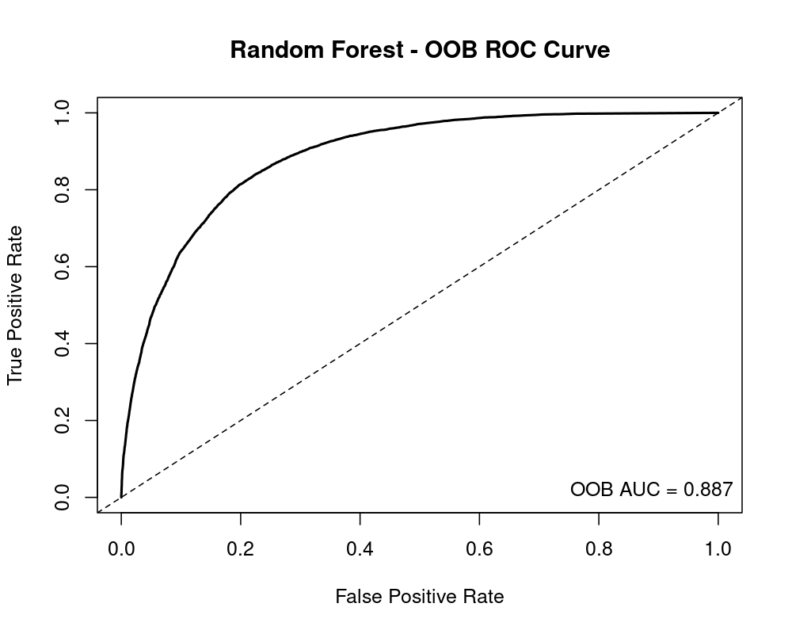
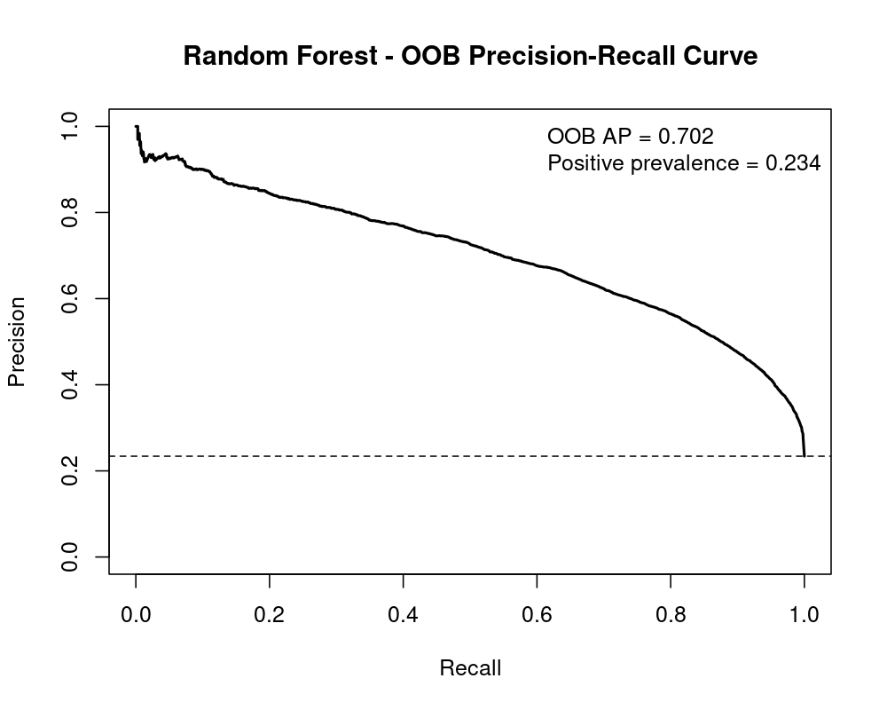

# m6APrediction

## Overview

m6APrediction is an R package for predicting RNA
N6-methyladenosine (m6A) modification sites using a
pre-trained random forest model.

The package uses sequence information and biological
features to predict m6A modification probabilities
and classification statuses.

It supports both single-sample and batch prediction.

## Installation

Install the package from GitHub:

```r
install.packages("remotes")
remotes::install_github("zeyu-liuu2/m6APrediction")
```

Load the package:

```r
library(m6APrediction)
```

## Input Features

The prediction model uses seven input features:

- gc_content
- RNA_type
- RNA_region
- exon_length
- distance_to_junction
- evolutionary_conservation
- DNA_5mer

## Example 1: Batch Prediction

Load the pre-trained random forest model and
example dataset:

```r
library(m6APrediction)

ml_fit <- readRDS(system.file(
  "extdata", "rf_fit.rds",
  package = "m6APrediction"
))

example_df <- read.csv(system.file(
  "extdata", "m6A_input_example.csv",
  package = "m6APrediction"
))

batch_result <- prediction_multiple(
  ml_fit,
  example_df,
  positive_threshold = 0.6
)

head(batch_result)
```

The function returns predicted m6A probabilities
and classification statuses for multiple samples.

## Example 2: Single-Sample Prediction

```r
single_result <- prediction_single(
  ml_fit = ml_fit,
  gc_content = 0.6,
  RNA_type = "mRNA",
  RNA_region = "CDS",
  exon_length = 12,
  distance_to_junction = 5,
  evolutionary_conservation = 0.8,
  DNA_5mer = "GGACA",
  positive_threshold = 0.5
)

print(single_result)
```

The function returns the predicted probability
and m6A classification status for one sample.


## Model Performance

The random forest model was evaluated using
out-of-bag (OOB) predictions from the training
dataset.

The ROC curve illustrates the relationship between
the true positive rate and false positive rate.
The OOB ROC AUC is approximately 0.887.

The precision-recall curve illustrates the
relationship between precision and recall.
It is particularly useful for evaluating
classification performance on imbalanced datasets.

These results represent OOB evaluation rather
than performance on an independent test dataset.

### ROC Curve



### Precision-Recall Curve



## License

This package is distributed under the MIT License.
